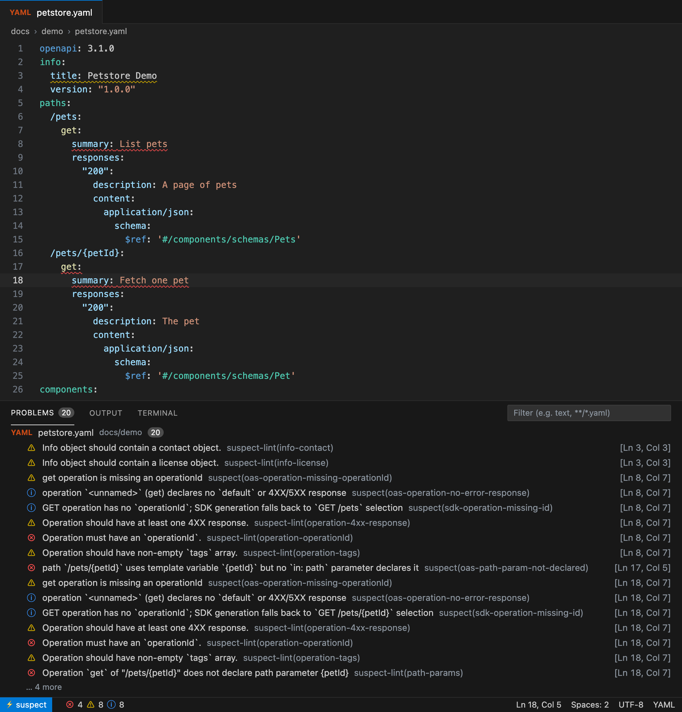
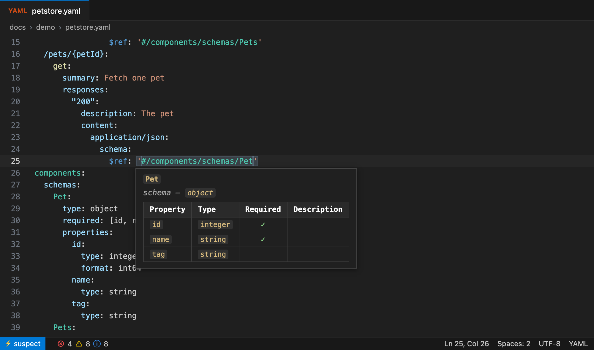
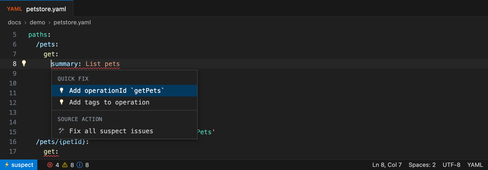
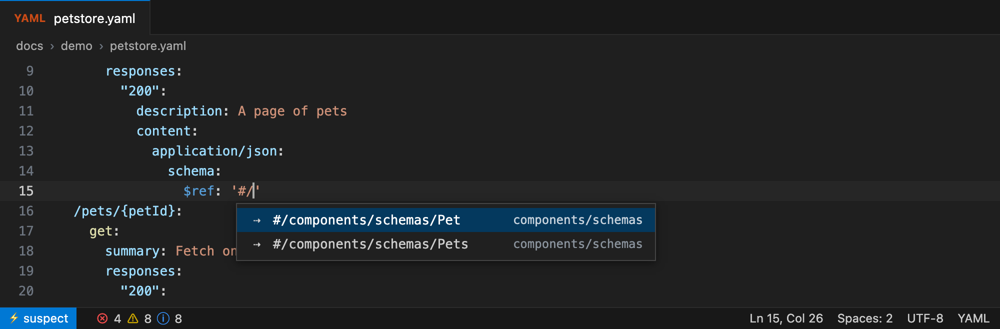
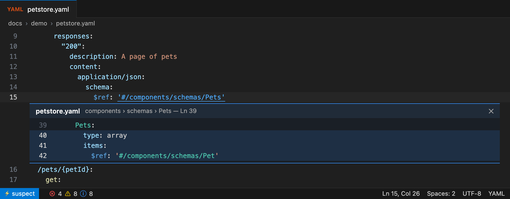
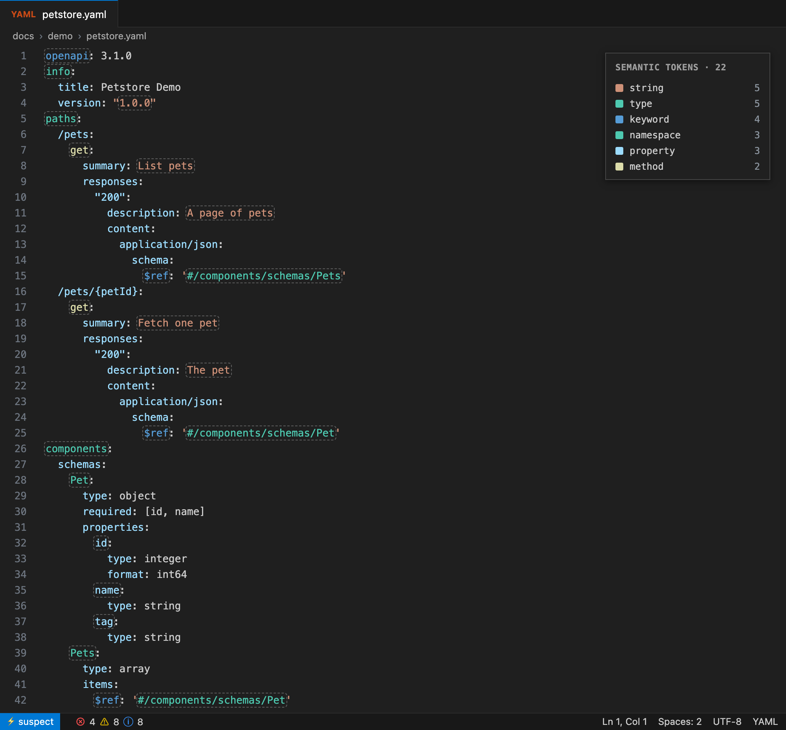
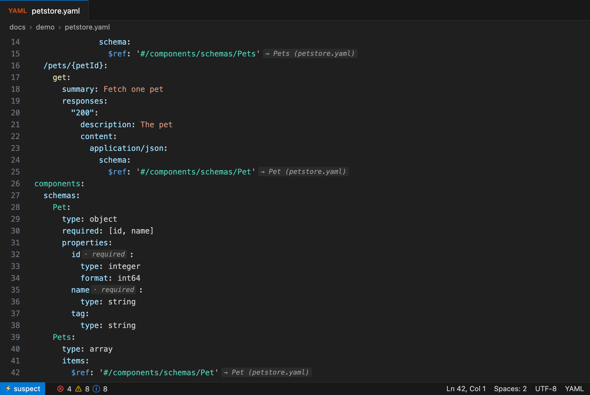
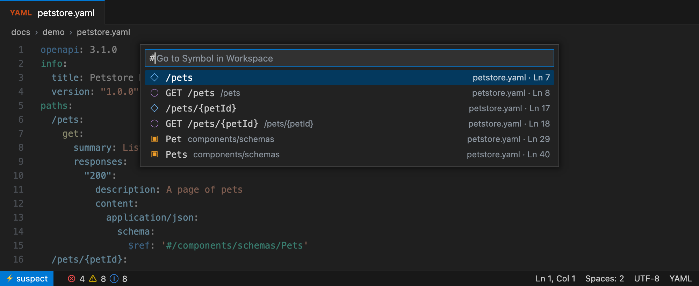
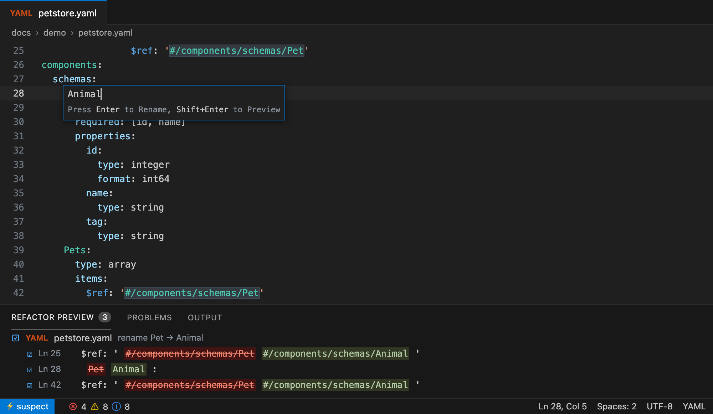

# suspect

High-performance Rust toolkit for OpenAPI (3.0, 3.1, 3.2; 2.0 read via family
sniffing), Arazzo 1.0, and Overlay 1.0: lossless tree-sitter parsing, native
`$ref` resolution with cycle classification, JSON Schema 2020-12 validation,
Spectral-compatible linting, an LSP server, and a CLI.

Design constraints: parse once, view many; zero-copy scalars; arena-indexed
nodes; lazy memoized resolution. Benchmarks with honest budget verdicts live
in [BENCHMARKS.md](BENCHMARKS.md).

SDK generation uses one source-addressed contract pipeline for twelve native
backends — **TypeScript/JavaScript, Python, Go, Rust, Swift, Java, Kotlin, C#,
Ruby, PHP, Dart and C++** — producing native models, checked codecs, HTTP
operations, packages, golden-defaults behavior (attribution, pagination,
OAuth, env-credential defaults) and documentation.
The [hackathon demo](docs/SDK-DEMO.md) generates SDKs from the real
OpenRouter specification. See [SDK capabilities](docs/SDK-CAPABILITIES.md) and
[verified demo scope](docs/SDK-PROGRESS.md).

## Install

Prebuilt binaries for macOS, Linux (glibc and static musl) and Windows are
attached to every [release](https://github.com/LukasParke/suspect/releases)
(Windows is tier 2 until one release has passed its smoke tests):

```console
# macOS and Linux
curl --proto '=https' --tlsv1.2 -LsSf https://github.com/LukasParke/suspect/releases/latest/download/suspect-cli-installer.sh | sh
# Homebrew
brew install LukasParke/tap/suspect
# Windows
powershell -ExecutionPolicy Bypass -c "irm https://github.com/LukasParke/suspect/releases/latest/download/suspect-cli-installer.ps1 | iex"
# From source (needs Rust)
cargo install --locked --git https://github.com/LukasParke/suspect suspect-cli
suspect --version
```

The installers put `suspect` in `~/.cargo/bin`, the same place `cargo
install` uses. Each archive (`suspect-cli-<target>.tar.gz`, `.zip` on
Windows) has a `.sha256` file next to it, and `gh attestation verify <file>
--repo LukasParke/suspect` checks its build provenance.

In GitHub Actions, `LukasParke/suspect/.github/actions/suspect@v<version>`
downloads the release binary and can run `check`, `test` or `gen`
([`action.yml`](.github/actions/suspect/action.yml)).

## LSP — full-featured editor experience

`suspect lsp` is a complete language server for OpenAPI/Arazzo/Overlay files.
The repo ships a VS Code extension in [`editors/vscode/`](editors/vscode/)
and a Zed extension in [`editors/zed/`](editors/zed/), and any LSP
client works — Neovim, Helix, Zed, Emacs (lsp-mode/eglot).

**Capabilities**: publishDiagnostics (syntax + 22 semantic checks + 21 lint
rules + Arazzo validation, debounced), goto-definition and references across
`$ref` boundaries (multi-file), hover with resolved target previews,
context-aware completions (`$ref` candidates from the workspace), quick fixes
and `source.fixAll.suspect`, document formatting, semantic highlighting,
`$ref`-target inlay hints, property type hints, document highlights,
selection ranges, rename with workspace-wide `$ref` rewriting
(`prepareRename` guarded), workspace symbols, folding ranges.

## How we compare

A detailed feature-by-feature comparison against **vacuum** (pb33f/daveshanley)
and **Telescope** (sailpoint-oss) is in
[docs/LSP_COMPARISON.md](docs/LSP_COMPARISON.md).

### In action (VS Code + the bundled extension)

Every screenshot below is drawn from real server output for
[`docs/demo/petstore.yaml`](docs/demo/petstore.yaml). Regenerate them with
`cargo run --example showcase -p suspect-lsp && python3 docs/capture/render.py`
(needs Chrome and Pillow).

Diagnostics from the validator and the Spectral-compatible linter, in the
editor and the Problems panel:



Hover over a `$ref` resolves it (across files, too) and previews the target:



Quick fixes derived from diagnostics, plus `source.fixAll.suspect`:



Completions inside a `$ref` offer the components declared across the
workspace:



Go to definition peeks at the `$ref` target:



Semantic highlighting; the legend lists the token types in this file:



Inlay hints name each `$ref` target and mark required properties:



Workspace symbols cover paths, operations and components:



Workspace-wide rename rewrites the declaration and every `$ref` that points
at it (guarded by `prepareRename`; cross-file edits land in one atomic
`WorkspaceEdit`) — shown here renaming `Pet`:




## Crates

| Crate | Purpose |
|---|---|
| `suspect-source` | Loading: mmap, encodings (UTF-8/16, BOM), line indexes, URIs |
| `suspect-syntax` | Lossless tree-sitter CSTs (vendored grammars, patched for >32k-line YAML) |
| `suspect-low` | Ordered model, source maps, YAML 1.2 typing, aliases/merge keys, pointers |
| `suspect-ref` | `$ref` engine: workspace graph, cycle census (legal vs illegal), memos |
| `suspect-jsonpath` | RFC 9535 JSONPath over low nodes |
| `suspect-schema` | Source-bound JSON Schema validation and checked owned programs for SDK codecs |
| `suspect-oas` | Typed OpenAPI 3.x views; `$ref`-transparent, cycle-safe |
| `suspect-ir` | Source-addressed SDK `Contract`, indexed platform snapshots, deterministic example values (`faker`) |
| `suspect-codegen` | Native SDK models, codecs, HTTP packages, docs, sessions and compatibility |
| `suspect-gen` | Markdown documentation preset and custom manifest/template rendering |
| `suspect-artifact` | Shared ownership-aware output, drift checks and changed-file writes |
| `suspect-overlay` | Overlay 1.0 models + apply engine |
| `suspect-arazzo` | Arazzo 1.0 models, runtime expressions, cross-ref validation |
| `suspect-test` | Arazzo plan compiler, observable executor, load generator (profiles, scheduler, metrics, SLO gates), reporters |
| `suspect-validate` | Source-located semantic checks with stable diagnostic codes |
| `suspect-lint` | Spectral-compatible rulesets and builtin rules |
| `suspect-config` | One settings schema (`.suspect.yaml`) and precedence rule for the CLI and LSP |
| `suspect-runtime` | Shared contract runtime: one interpretation of a contract for every surface |
| `suspect-journal` | Structured JSONL journals, traffic records, Suspect Cassette format |
| `suspect-gateway` | HTTP contract gateway: mock, proxy, validate, record, replay |
| `suspect-rules` | TS/JS custom rule runtime (Bun sidecar) |
| `suspect-lsp` | tower-lsp server: diagnostics, goto-def/references, hover, symbols, completion |
| `suspect-cli` | `suspect` binary: authoring, SDK generation, tests, gateway and editor commands |

## CLI

```console
$ suspect check spec.yaml              # parse + resolve report, cycle census
$ suspect validate spec.yaml           # source-located semantic findings
$ suspect lint spec/ --format json     # Spectral-style linting
$ suspect bundle api.yaml --strategy inline -o bundled.yaml
$ suspect overlay apply overlay.yaml api.yaml -o out.yaml
$ suspect diff old.yaml new.yaml
$ suspect stats api.yaml
$ suspect fmt api.yaml --to json
$ suspect bench fixture.yaml           # per-stage timings
$ suspect test flows.arazzo.yaml --base-url http://localhost:8080 --input petName=Rex
$ suspect load profile.load.yaml       # Artillery-style load test from Arazzo scenarios
$ suspect lsp                          # stdio language server
$ suspect gateway api.yaml -p 8080 --mode mock
$ suspect gateway api.yaml -p 9000 --mode record --upstream http://staging:80 --cassette rec.scj
$ suspect gateway api.yaml -p 9001 --mode replay --cassette rec.scj
$ suspect test flows.arazzo.yaml --cassette rec.scj
$ suspect fuzz api.yaml --base-url http://localhost:8080 --runs 50
$ suspect watch . -- suspect test flows.arazzo.yaml --cassette rec.scj
$ suspect config                       # settings in effect, and where they came from
```

Every command is listed with its flags in the generated
[command reference](docs/CLI.md); the [documentation index](docs/README.md)
groups the guides. Exit codes are shared: `0` clean, `1` findings or failed
checks, `2` usage or environment error.

## SDK generation

Generate the shared create/update/list/get example contract:

```sh
suspect codegen crates/suspect-codegen/tests/fixtures/m2/canonical.openapi.yaml \
  --profile typescript-http --package-name @example/widgets \
  --package-version 0.1.0 -o generated
```

Profiles are the twelve registered backends listed by `suspect
codegen-profiles` (`typescript-http`, `python-http`, `go-http`, `rust-http`,
`swift-http`, `java-http`, `kotlin-http`, `csharp-http`, `ruby-http`,
`php-http`, `dart-http`, `cpp-http`). Package identity is explicit
configuration. Repeat
`--operation-id NAME` to select exact source operations; omitting it attempts
all outgoing operations. Unsupported selected contracts produce source-linked
diagnostics before output. Add `--check --format json` for read-only drift checks.

For multi-target generation, watch and editor previews, use
[`codegen-session`](docs/SDK-INCREMENTAL-GENERATION.md). Compare source snapshots
and generated interfaces with [`codegen-compare`](docs/SDK-COMPATIBILITY-REPORTS.md).
Markdown and custom templates use `suspect gen api.yaml --preset docs-md` or
`suspect gen api.yaml --manifest FILE`; native SDK docs are emitted by each profile.

## Contract and load testing

`suspect test` compiles an Arazzo document into an executable suite and
runs it against a live server or a recorded cassette; `suspect load` runs
the **same workflows** as weighted virtual-user scenarios under a phased
arrival profile (`arrivalRate`/`rampTo`, `arrivalCount`, `pause`,
closed-loop `vus`), with HDR-histogram latency percentiles, status and
error breakdowns, contract-failure rate, SLO gates (`ensure`) and
JSON/JUnit reports. Load profiles are `suspectLoad: "1.0"` YAML files
with editor diagnostics. See [docs/LOAD-TESTING.md](docs/LOAD-TESTING.md)
and the runnable example in [`examples/load/`](examples/load/).

## Gateway, recording and replay

`suspect gateway` serves a spec as a mock, or proxies an upstream while
validating, recording or replaying traffic. Recorded traffic feeds offline
contract tests (`suspect test --cassette`), drift reports
(`suspect drift`), HAR export (`suspect har`) and impact analysis
(`suspect impact`).

### Cassette format

Suspect Cassette `.scj`: JSONL — header line (`format`, `version`,
`recorded_at_ms`, `source`) then one entry per exchange with sha256-hashed
bodies (UTF-8 or base64). Append-only, git-diffable, consumed by replay,
offline tests, and drift checks.

## Roadmap

The next platform features are tracked in
[docs/FEATURE-ROADMAP.md](docs/FEATURE-ROADMAP.md); the toolchain alignment
plan is [docs/proposals/](docs/proposals/README.md).

## Notable engineering

- **Vendored grammars**: `crates/suspect-syntax/grammars/` with a local patch
  widening the YAML scanner's `int16_t` row tracking to `int32_t` — upstream
  tree-sitter-yaml v0.7.2 corrupts parses beyond 32,767 lines; suspect handles
  100k+-line documents (guarded by `crates/suspect-low/tests/large_yaml.rs`).
- **Cycle taxonomy**: `$ref` loops are classified as legal schema recursion or
  illegal (unresolvable) loops with exact cycle paths — never stack overflow,
  never hangs.
- **CI**: `.github/workflows/ci.yml` gates fmt, clippy (`-D warnings`), tests,
  and a bench smoke run.

## Editors

- **VS Code** ([`editors/vscode`](editors/vscode/)): language features via the
  bundled LSP, a Testing-API explorer for Arazzo workflows, an Arazzo notebook,
  gateway control and SDK generation. Releases publish it to the VS Code
  Marketplace and Open VSX, and attach the `.vsix` to the GitHub release.
  Build it with `cd editors/vscode && npm ci && npm run compile`, then run it
  from VS Code's extension development host or package it with
  `npm run package`.
  The extension finds `suspect` on `PATH`; set `"suspect.basePath"` to use a
  specific binary.
- **Zed** ([`editors/zed`](editors/zed/)): registers `suspect lsp` for YAML and
  JSON; see its README for install and settings.
- **Others** (Neovim, Helix, Emacs): run `suspect lsp` over stdio; smoke
  configurations live in [`editors/multiclient/`](editors/multiclient/).

All clients share the same settings file: `.suspect.yaml` at the project root
(`suspect config` shows what is in effect).

## License

Licensed under either of [Apache License, Version 2.0](LICENSE-APACHE) or
[MIT](LICENSE-MIT), at your option. See [CONTRIBUTING.md](CONTRIBUTING.md)
for development setup.
